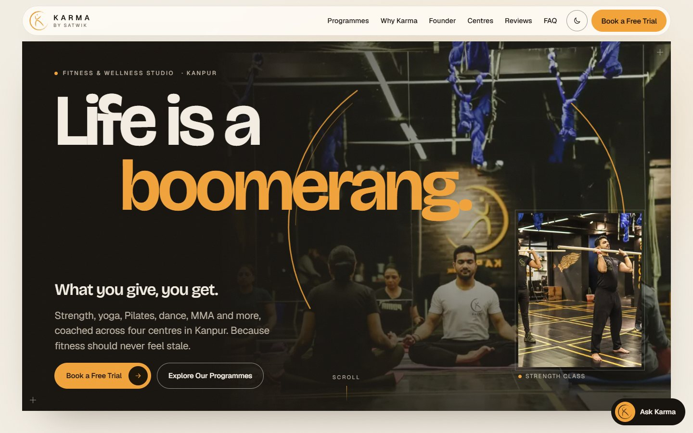
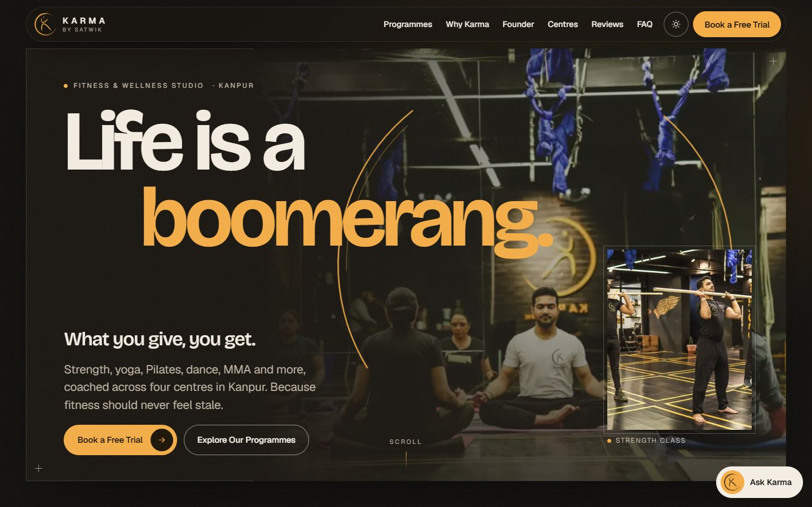
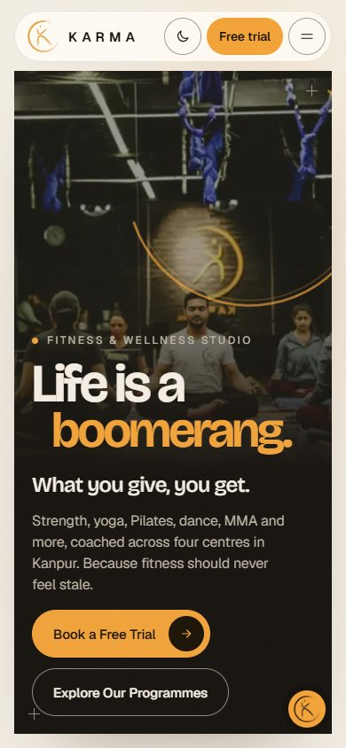

# Karma by Satwik: website redesign

A one-page site for Karma by Satwik, a unisex fitness and wellness studio with four centres in Kanpur. It has a cinematic opening, a filterable programme grid that links to the studio's existing programme pages, a founder section, Google reviews, the centres with directions, a free-trial enquiry form that hands off to WhatsApp, a franchise enquiry section with the brochure, and a scripted on-page assistant. There are light and dark themes. Built from the 8B "Arcline" template; the untouched template is at git tag `arcline-original`.

 



## Run it

No build step. Serve the folder with any static server, for example:

```bash
python -m http.server 8765
# then open http://127.0.0.1:8765/
```

Opening `index.html` directly from disk also works.

## Structure

- `index.html`: the page, its CSS (design tokens for both themes) and the GSAP/ScrollTrigger/Lenis scenes.
- `js/knowledge.js`: everything the assistant knows, sourced from karmabysatwik.com. `js/assistant.js`: matching and UI.
- `assets/`: client photos (WebP), logo masks, favicons, og-image, self-hosted fonts and animation libraries (GSAP, ScrollTrigger, Lenis). The page makes no requests to third-party servers.
- `robots.txt`, `sitemap.xml`: for deployment at https://karmabysatwik.com/.

See `AGENTS.md` for editing rules and the facts awaiting client confirmation, and `CREDITS.md` for photo, font and library sources.

## Before launch

1. The client confirms the open facts listed in AGENTS.md (Kidwai Nagar address, trial offer, contact numbers, Shyam Nagar, permission to quote reviews and to use the photos).
2. Choose the hosting. If this replaces the WordPress site, keep or redirect the existing programme pages (they are linked from the cards and probably carry search traffic).
3. Optional: connect a form service (`data-endpoint` on the form) so enquiries also arrive by email.
